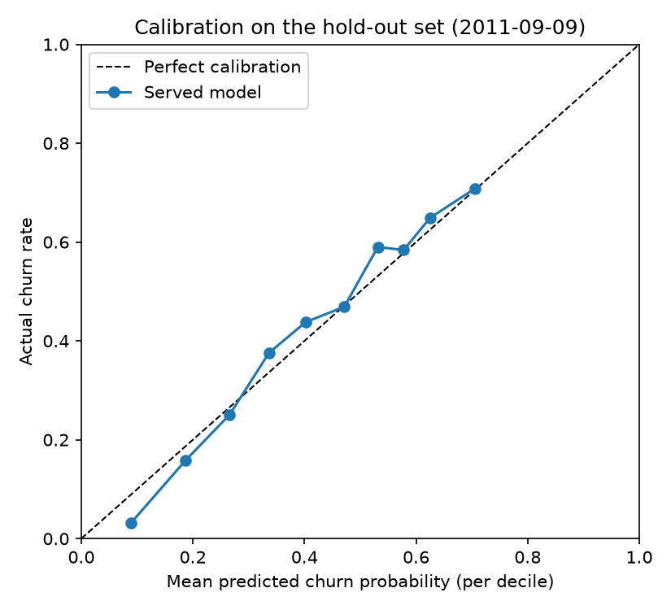

# Online Retail II – Customer Churn MLOps Pipeline

[](https://github.com/Elcebir71/Online_Retail_II/actions/workflows/ci-cd.yml)

**Live demo:** [Swagger UI](https://churn-api.orangeocean-d98c39b7.swedencentral.azurecontainerapps.io/docs)
(Azure Container Apps, scales to zero, so the first request may take ~15 s)

End-to-end MLOps project that predicts which customers of an online retailer will churn,
so marketing can target them with win-back campaigns.

**Stack:** scikit-learn · MLflow (tracking + model registry) · FastAPI · Docker · Kubernetes · GitHub Actions · Azure Container Apps · PSI drift monitoring

## Problem

The [UCI Online Retail II](https://archive.ics.uci.edu/dataset/502/online+retail+ii) dataset
contains ~1M invoice lines from a UK online retailer (Dec 2009 – Dec 2011). It has no churn
column, so the label is derived:

- Pick a **cutoff date**. Features are computed only from transactions *before* the cutoff.
- A customer is **churned (1)** if they make no purchase in the **90 days after** the cutoff.

Features (RFM and behaviour): recency, frequency, monetary value, average order value,
number of distinct products, tenure, return rate, orders in the last 90 days, country.

## Results

Time-based split: train on customers as of 2010-09-09, test on customers as of 2011-09-09
(same season one year later, no leakage from the future). Features use only the **270 days
before each cutoff** (see [Why a fixed window](#why-a-fixed-window)), so the test set holds the
3,223 customers who bought in that window. 42.5% of them churn, which is also the precision of
targeting customers at random.

**Model vs. simple rules** (`python -m src.evaluate`, 95% bootstrap interval in brackets):

| Ranking | ROC-AUC | PR-AUC | Precision@10% | Precision@20% | Recall@20% | Lift@20% |
|---|---|---|---|---|---|---|
| Recency rule (days since last purchase) | 0.684 [0.668–0.703] | 0.592 | 0.686 | 0.657 | 0.309 | 1.55 |
| No order in the last 90 days | 0.638 [0.622–0.654] | 0.518 | 0.562 | 0.546 | 0.257 | 1.28 |
| **Logistic regression** (served, v9) | **0.745** [0.729–0.762] | **0.639** | **0.708** | **0.679** | **0.320** | **1.60** |

The model beats the strongest rule by **+0.061 ROC-AUC** (95% interval +0.044 to +0.077) and is
more precise at every campaign size shown. Logistic regression was also compared with gradient
boosting, which overfits these few, near-monotonic features (0.74 vs. 0.77 ROC-AUC on the
full-history features).

What this means for marketing: the riskiest 20% of customers by model score churn at ~68%,
a lift of 1.6× over random targeting, and include a third of all churners. The decile table
shows where a retention budget stops paying off: from decile 7 on, churn rates fall below average.

| Decile (riskiest first) | 1 | 2 | 3 | 4 | 5 | 6 | 7 | 8 | 9 | 10 |
|---|---|---|---|---|---|---|---|---|---|---|
| Churn rate | 70.6% | 65.3% | 58.2% | 59.0% | 46.9% | 43.5% | 37.6% | 24.8% | 15.8% | 3.1% |
| Cumulative share of churners reached | 17% | 32% | 46% | 60% | 71% | 81% | 90% | 96% | 99% | 100% |


**Calibrated scores.** The served model is calibrated with Platt scaling on cross-validated
training predictions. On the test set it predicts 41.9% churn on average against 42.5% actual,
with a Brier score of 0.201 (0.244 for always predicting the churn rate), so `churn_score` can
be read as a churn probability.



### Why a fixed window

The first version computed features over each customer's full history. That looked good,
ROC-AUC 0.771, but a baseline comparison showed the model was only +0.009 better than the
recency rule (interval −0.003 to +0.021, not significant). The cause was the full history:

- **Dormant customers inflate the test set.** A customer who last bought 600 days ago is still
  "a customer" as of 2011, and is an easy churn case for any rule. They pushed the test churn
  rate to 56.8% (vs. 42.4% in training) and let recency alone explain almost everything.
- **That same shift broke calibration.** Probabilities calibrated on 2010 predicted 38.6% churn
  for 2011, and calibration made the Brier score worse (0.205 → 0.225).
- **Cumulative features drift by design.** `tenure_days`, `frequency` and `monetary` grow as the
  dataset gets older, so monitoring flagged drift even when behaviour was stable.

With a fixed 270-day window (the history available at the training cutoff), train and test
churn rates match (41.6% vs. 42.5%), calibration works, and the model's gain over the rule
becomes clear. The test set is harder, hence the lower headline ROC-AUC, but the comparison is
fairer.

| Feature history | Test customers | Test churn | Model ROC-AUC | Recency rule | Gain over rule |
|---|---|---|---|---|---|
| Full history (v6) | 5,278 | 56.8% | 0.771 | 0.762 | +0.009 [−0.003, +0.021] |
| Last 270 days (v9) | 3,223 | 42.5% | 0.745 | 0.684 | **+0.061** [+0.044, +0.077] |

## Comparison with related work

Published churn models often report 91–99% accuracy, against ROC-AUC 0.745 here. The gap comes
from the evaluation setup, not from better models. `python -m src.compare_methods` reproduces
the setups on this dataset and tests the published methods under the time-based split.

| Study | Data | Reported | Why it is not comparable |
|---|---|---|---|
| Hybrid RFM + Deep Embedded Clustering + LSTM/GRU ([Scientific Reports, 2026](https://www.nature.com/articles/s41598-026-53220-0)) | UCI Online Retail (the 2010–2011 part of this dataset) | 99.65% accuracy (LSTM), ROC-AUC 0.99996 for logistic regression | Churn is defined as `Recency > 90 days` and Recency is also a model input, so the model re-learns its own label rule. No cutoff date and no future window, random split. |
| Enhanced Customer Churn Prediction in Banking: ANOVA, PCA, SMOTE, RF/XGBoost/SVM | UCI Bank Marketing (bank-additional) | 91.18% accuracy, ROC-AUC 0.94 (XGBoost) | Term-deposit subscription, not churn. 89% of clients answer "no", so always predicting "no" already scores 89%. The `duration` field is only known after the call ends (a leak, as the [dataset's EDA](https://alexkataev.medium.com/uci-bank-marketing-dataset-part-1-exploratory-data-analysis-eda-f3108f3982b4) also notes). Random split, although the "yes" rate changes year by year. |
| Bank churn with SMOTE + genetic-algorithm feature selection, RF/KNN/ANN/AdaBoost | Static bank customer table (no transactions) | 96% accuracy, precision and F1 (KNN) | Equal accuracy, precision and F1 suggest metrics on oversampled, balanced data. If SMOTE runs before the split, synthetic copies of test customers end up in training, which favours KNN in particular. No ROC-AUC on the real class mix, no baseline. |

The three experiments, on this dataset (results: `reports/comparison.md`):

1. **Label leakage.** With the published label (`Recency > 90 days` at the end of the data,
   random 80/20 split) our plain logistic regression reaches **ROC-AUC 1.000 and 100% accuracy**
   on the same 4,338 customers the study used. With a real future label it scores 0.745.

   | Setup | ROC-AUC | Accuracy |
   |---|---|---|
   | Published label: churn = recency > 90 days, recency as input | 1.000 | 1.000 |
   | This project: no purchase in the 90 days after the cutoff | 0.745 | 0.668 |

2. **SMOTE before the split.** KNN on 2010 customers with a random split gains +0.071 ROC-AUC
   just by oversampling before splitting, and the test set becomes an artificial 50/50 mix.

   | Setup (KNN, k=5) | ROC-AUC | Accuracy | Churn rate in test set |
   |---|---|---|---|
   | SMOTE on all data, then split (leaky) | 0.730 | 0.662 | 50.0% |
   | Split, then SMOTE on the training part only | 0.659 | 0.599 | 41.6% |

3. **Published methods in our setup** (train 2010-09-09, test 2011-09-09, 3,223 customers).
   None beats the served logistic regression in a meaningful way: ANOVA selection is +0.002,
   PCA and SMOTE change nothing (the classes are already 42/58), and the more flexible models
   (random forest, boosting, SVM, KNN) are all lower. With eight RFM features, the extra capacity
   fits noise rather than signal.

   | Model | ROC-AUC | PR-AUC | Precision@20% | Lift@20% | Gain over recency rule |
   |---|---|---|---|---|---|
   | Recency rule | 0.684 | 0.592 | 0.657 | 1.55 | reference |
   | **Logistic regression (served)** | **0.745** | **0.639** | **0.679** | **1.60** | **+0.061** [+0.044, +0.077] |
   | + ANOVA top-5 features | 0.747 | 0.640 | 0.673 | 1.58 | +0.063 [+0.046, +0.078] |
   | + PCA (95% variance) | 0.745 | 0.639 | 0.679 | 1.60 | +0.061 [+0.044, +0.077] |
   | + SMOTE (training data only) | 0.746 | 0.640 | 0.679 | 1.60 | +0.061 [+0.044, +0.077] |
   | AdaBoost | 0.741 | 0.628 | 0.640 | 1.51 | +0.057 [+0.040, +0.072] |
   | Random forest | 0.740 | 0.620 | 0.662 | 1.56 | +0.055 [+0.038, +0.072] |
   | Gradient boosting | 0.735 | 0.623 | 0.651 | 1.53 | +0.050 [+0.033, +0.068] |
   | SVM (RBF) | 0.732 | 0.630 | 0.665 | 1.57 | +0.048 [+0.030, +0.065] |
   | KNN (k=15) | 0.718 | 0.597 | 0.636 | 1.50 | +0.034 [+0.015, +0.051] |
   | KNN (k=15) + SMOTE (training data only) | 0.714 | 0.595 | 0.651 | 1.53 | +0.030 [+0.011, +0.046] |

Takeaway: the 99% figures measure the label definition, not the model. In an honest setup the
published methods land between −0.031 and +0.002 ROC-AUC of a simple logistic regression, so the served model
stays the simplest, best-calibrated choice.

## Project structure

```
src/
  data.py          # download + clean raw data -> data/processed/transactions.parquet
  features.py      # RFM features and churn label for a given cutoff
  train.py         # train, evaluate, log to MLflow, optionally register
  export_model.py  # promote a version to "champion" and export it to model/
  api.py           # FastAPI service (/health, /predict)
  monitor.py       # data drift (PSI) and performance monitoring (dataset or API prediction log)
  replay.py        # send real customers to the API to simulate traffic
  evaluate.py      # model vs. rule baselines, precision@k, lift, bootstrap CIs
  compare_methods.py  # published setups and methods (leaky label, SMOTE, RF, KNN, SVM, ...) in our setup
model/             # exported champion model served by the API and the Docker image
tests/             # unit tests for features and the API
k8s/              # Kubernetes Deployment + Service (kind / minikube)
Dockerfile
.github/workflows/ci-cd.yml
```

## Quick start

```bash
python -m venv .venv
source .venv/bin/activate        # Windows: .\.venv\Scripts\Activate.ps1
pip install -r requirements.txt

python -m src.data                                # download and clean the data
python -m src.train --model logreg --register     # train and register in MLflow
python -m src.export_model --version <N>          # promote version N to champion and export
python -m src.evaluate                            # compare with rule baselines (reports/evaluation.md)
python -m src.compare_methods                     # published setups and methods vs. ours (reports/comparison.md)
mlflow ui                                         # compare runs at http://127.0.0.1:5000
```

### Serve the model

```bash
uvicorn src.api:app --reload      # http://127.0.0.1:8000/docs
```

or with Docker:

```bash
docker build -t churn-api .
docker run -it --rm -p 8000:8000 churn-api
```

or pull the image published by CI:

```bash
docker run -it --rm -p 8000:8000 ghcr.io/elcebir71/online-retail-churn:latest
```

### Run on Kubernetes (kind / minikube)

`k8s/` contains a Deployment (2 replicas, health probes on `/health`, non-root, resource limits)
and a ClusterIP Service for the published image.

```bash
kind create cluster --name churn          # or: minikube start
kubectl apply -k k8s/
kubectl rollout status deployment/churn-api
kubectl port-forward service/churn-api 8000:80   # http://127.0.0.1:8000/docs
```

`k8s/kustomization.yaml` deploys `latest` by default. For a reproducible deploy, pin the image
of a specific commit (CI tags every image on `main` with its commit SHA):

```bash
cd k8s && kustomize edit set image ghcr.io/elcebir71/online-retail-churn:<commit-sha> && cd ..
```

To test a locally built image instead of the GHCR one:

```bash
docker build -t churn-api:dev .
kind load docker-image churn-api:dev --name churn     # minikube: minikube image load churn-api:dev
kubectl set image deployment/churn-api churn-api=churn-api:dev
```

Clean up with `kubectl delete -k k8s/` and `kind delete cluster --name churn`.

Example request:

```bash
curl -X POST http://127.0.0.1:8000/predict \
  -H "Content-Type: application/json" \
  -d '{"customers": [{"recency_days": 45, "frequency": 6, "monetary": 1250.5, "avg_order_value": 208.4,
       "n_products": 38, "tenure_days": 250, "return_rate": 0.02, "orders_last_90d": 1,
       "country": "United Kingdom"}]}'
```

```json
{"model_version": "9", "predictions": [{"churn_score": 0.2302, "high_risk": false}]}
```

`churn_score` is a calibrated churn probability for the next 90 days. `high_risk` is true when
the score would put the customer in the riskiest 20% of the training customers; the cut-off
(0.594 for v9) is computed from `model/reference.parquet` at startup. `/health` shows it together
with `lookback_days`, the window over which clients must compute the features (270 days).

## CI/CD

On every push and pull request, GitHub Actions:

1. Lints the code with **ruff**, runs the **pytest** suite and validates the Kubernetes
   manifests against the API schema (kubeconform).
2. Builds the Docker image and **smoke tests** it (`/health`, `/predict`, prediction log written).
3. Deploys the image to a throwaway **kind** cluster with the manifests in `k8s/` and runs the
   same checks through the Kubernetes Service.
4. On `main` only: publishes the image to **GitHub Container Registry**
   (`latest` and commit-SHA tags).
5. On `main` only: deploys the image **of that commit** (SHA tag, not `latest`) to Azure Container
   Apps and checks that the live service is healthy.

### Deployment

The live demo runs on **Azure Container Apps** (scale to zero, external HTTPS ingress). The CD job
logs in to Azure with **OpenID Connect**: GitHub issues a short-lived token for this repository's
`production` environment, so no Azure password or key is stored anywhere.

**Rollback** = deploy the image of an earlier commit:

```bash
az containerapp update --name churn-api --resource-group rg-rag-demo \
  --image ghcr.io/elcebir71/online-retail-churn:<earlier-commit-sha>
```

or re-run that commit's workflow from the GitHub Actions tab.

<details>
<summary>One-time setup (Azure app registration for GitHub OIDC)</summary>

```bash
az containerapp create --name churn-api --resource-group rg-rag-demo --environment <env> \
  --image ghcr.io/elcebir71/online-retail-churn:latest --target-port 8000 \
  --ingress external --min-replicas 0 --max-replicas 1

APP_ID=$(az ad app create --display-name github-online-retail-churn --query appId -o tsv)
az ad sp create --id $APP_ID
az ad app federated-credential create --id $APP_ID --parameters '{"name": "github-production",
  "issuer": "https://token.actions.githubusercontent.com",
  "subject": "repo:Elcebir71@30794214/Online_Retail_II@1429766320:environment:production",
  "audiences": ["api://AzureADTokenExchange"]}'
az role assignment create --assignee $APP_ID --role Contributor \
  --scope $(az group show --name rg-rag-demo --query id -o tsv)
```

Then add the repository **variables** (Settings → Secrets and variables → Actions → Variables)
`AZURE_CLIENT_ID` (= `$APP_ID`), `AZURE_TENANT_ID` and `AZURE_SUBSCRIPTION_ID`
(from `az account show`). The deploy job is skipped while `AZURE_CLIENT_ID` is not set.

The subject uses GitHub's immutable format (owner and repository with their numeric IDs), so
it keeps working if the repository is renamed. If Azure rejects the login with `AADSTS700213`,
copy the subject from the error message into the federated credential.

</details>

## Monitoring

`src/monitor.py` compares current customers with the training snapshot that is exported next
to the served model (`model/reference.parquet`). The current customers come from one of two
sources:

- **Live traffic:** the API appends every scored customer (features, `churn_score`,
  `high_risk`, model version, timestamp) to a JSON lines log (`PREDICTION_LOG`, default
  `logs/predictions.jsonl`). This measures drift on what the service actually receives.
- **Historical simulation:** customer features rebuilt from the dataset at past cutoff dates.
  Here the churn labels are known, so performance can be tracked too.

What is measured:

- **Data drift:** Population Stability Index (PSI) for every feature and for the predicted
  churn probability (< 0.1 stable, 0.1–0.25 warning, ≥ 0.25 drift). Implemented from scratch
  with quantile bins from the reference data.
- **Performance:** ROC-AUC and PR-AUC once the 90-day churn labels of the period are known.
- **Alert:** retraining is recommended when a feature drifts significantly, the prediction
  distribution shifts, or ROC-AUC drops more than 0.05 below the reference.

```bash
# Historical simulation over four dates
python -m src.monitor --cutoff 2010-12-01 2011-03-01 2011-06-01 2011-09-09

# Live traffic: start the API, send it real customers, then monitor its prediction log
docker run --rm -p 8000:8000 -v ${PWD}/logs:/app/logs churn-api
python -m src.replay --cutoff 2011-09-09          # posts the customers as of that date to the API
python -m src.monitor --prediction-log logs/predictions.jsonl [--since 2026-10-01]
```

Each run produces `reports/monitoring_<date or live>.html` and `.json` and an MLflow run in the
`online-retail-churn-monitoring` experiment, so PSI and AUC can be plotted over time in the
MLflow UI. `--fail-on-alert` makes the script exit with code 1, so it can gate a scheduled job.

**Finding:** with full-history features (v6), `recency_days` and `tenure_days` drifted in most
periods, simply because customer histories get longer as the dataset ages. With the 270-day
window (v9), recency no longer drifts at all, and ROC-AUC stays between 0.745 and 0.774:

| Monitoring date | 2010-12-01 | 2011-03-01 | 2011-06-01 | 2011-09-09 |
|---|---|---|---|---|
| Customers | 3,950 | 3,841 | 3,898 | 3,223 |
| ROC-AUC | 0.759 | 0.774 | 0.765 | 0.745 |
| Drift (PSI ≥ 0.25) | – | `tenure_days` | `tenure_days` | – |

The remaining `tenure_days` drift appears in spring and summer only and disappears again in
September, the training season: it is seasonal (who first bought within the window), not
structural, which is the kind of drift a monitor should report.

## Limitations

Known weaknesses, stated up front:

- **Customers inactive for more than 270 days are not scored.** They fall outside the feature
  window and are effectively lost already; they belong in a win-back campaign, not a churn
  model. The window is also capped by the data: with more history, a 12-month window would
  cover a full seasonal cycle.
- **Modest absolute performance.** ROC-AUC 0.745 on RFM features alone. More signal would need
  product categories, discounts or customer-level seasonality, which the dataset does not
  describe well.
- **The `high_risk` cut-off is not cost-based.** It flags the riskiest 20% of training customers.
  With calibrated scores, a cut-off from the cost of a retention offer vs. the value of a saved
  customer would be the better choice once those numbers are known.
- **Live monitoring is drift-only and the log is local.** Predictions are logged to a file, so
  drift on real traffic can be measured, but churn labels for live customers only exist 90 days
  later and are not joined back yet. The log is a local file per container: it is lost on a
  restart or when the Azure demo scales to zero, and with two Kubernetes replicas it is split in
  two. In production it would go to shared storage (Azure Files or Blob Storage) or a log store
  such as Azure Log Analytics.
- **One test period.** All test metrics come from a single cutoff (2011-09-09). The bootstrap
  intervals cover sampling noise between customers, not variation between time periods.
- **No separate validation period.** The baseline comparison, the calibration method and the
  270-day window were all chosen by looking at results on the 2011 test set, so the test metrics
  are somewhat optimistic. A cleaner setup would make these choices on a validation cutoff
  (for example 2011-03-01) and use 2011-09-09 only once, for the final numbers.

## Roadmap

- [x] Data pipeline, churn label and model tracking with MLflow
- [x] FastAPI service and Docker image
- [x] CI/CD with GitHub Actions
- [x] Data drift and performance monitoring
- [x] Baseline comparison, precision@k, lift and bootstrap confidence intervals
- [x] Calibrated churn probability (Platt scaling) with a top-20% risk flag
- [x] Log served predictions and monitor drift on live traffic
- [x] Kubernetes deploy tested in CI (kind); SHA-pinned deploy to Azure with OIDC login
- [x] Fixed 270-day feature window: removes structural drift and makes calibration work
- [x] Comparison with published studies: their setups and methods reproduced on this data
- [ ] Scheduled monitoring job with automatic retraining
