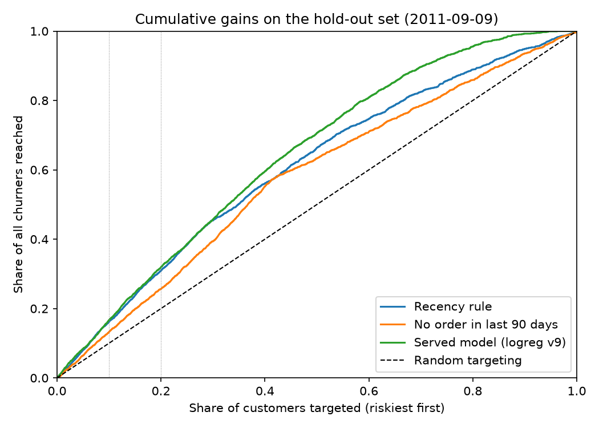

# Online Retail II – Customer Churn MLOps Pipeline

[](https://github.com/Elcebir71/Online_Retail_II/actions/workflows/ci-cd.yml)

**Live demo:** [Swagger UI](https://churn-api.orangeocean-d98c39b7.swedencentral.azurecontainerapps.io/docs)
(Azure Container Apps, scales to zero, so the first request may take ~15 s)

End-to-end MLOps project that predicts which customers of an online retailer will churn,
so marketing can target them with win-back campaigns.

**Stack:** scikit-learn · MLflow (tracking + model registry) · FastAPI · Docker · Kubernetes · GitHub Actions · Azure Container Apps · PSI drift monitoring

## Problem

The [UCI Online Retail II](https://archive.ics.uci.edu/dataset/502/online+retail+ii) dataset
contains ~1M invoice lines from a UK online retailer (Dec 2009 – Dec 2011). It has no churn
column, so the label is derived:

- Pick a **cutoff date**. Features are computed only from transactions *before* the cutoff.
- A customer is **churned (1)** if they make no purchase in the **90 days after** the cutoff.

Features (RFM and behaviour): recency, frequency, monetary value, average order value,
number of distinct products, tenure, return rate, orders in the last 90 days, country.

## Results

Time-based split: train on customers as of 2010-09-09, test on 5,278 customers as of 2011-09-09
(same season one year later, no leakage from the future). 56.8% of test customers churn, which is
also the precision of targeting customers at random.

**Model vs. simple rules** (`python -m src.evaluate`, 95% bootstrap interval in brackets):

| Ranking | ROC-AUC | PR-AUC | Precision@10% | Precision@20% | Recall@20% | Lift@20% |
|---|---|---|---|---|---|---|
| Recency rule (days since last purchase) | 0.762 [0.749–0.776] | 0.801 | 0.905 | 0.868 | 0.306 | 1.53 |
| No order in the last 90 days | 0.688 [0.675–0.700] | 0.684 | 0.716 | 0.711 | 0.251 | 1.25 |
| **Logistic regression** (served, v6) | **0.771** [0.759–0.783] | 0.793 | 0.866 | 0.839 | 0.296 | 1.48 |
| HistGradientBoosting | 0.74 | 0.76 | | | | |

**The honest reading:** the model is only **+0.009 ROC-AUC** better than ranking customers by
recency alone, and the 95% interval of that gain (−0.003 to +0.021) includes zero. For a
campaign aimed at the riskiest 10–20% of customers, the recency rule is even slightly more
precise. In this dataset, *when did the customer last buy* carries almost all of the signal; the
other RFM features add little on top. Logistic regression still beats gradient boosting, which
overfits these few, near-monotonic features.

What this means for marketing: targeting the riskiest 20% (by either the model or recency)
reaches customers of whom ~84–87% would churn, a lift of ~1.5× over random targeting, and
covers ~30% of all churners. The decile table shows where the budget stops paying off: from
decile 6 on, churn rates fall below the average.

| Decile (riskiest first) | 1 | 2 | 3 | 4 | 5 | 6 | 7 | 8 | 9 | 10 |
|---|---|---|---|---|---|---|---|---|---|---|
| Churn rate | 86.6% | 81.2% | 77.8% | 69.1% | 65.3% | 57.6% | 52.5% | 42.2% | 26.4% | 8.9% |
| Cumulative share of churners reached | 15% | 30% | 43% | 56% | 67% | 77% | 86% | 94% | 98% | 100% |



The gains chart shows where the small ROC-AUC gain comes from: model and recency rule are
indistinguishable for the riskiest ~60% of customers, and the model only pulls ahead in the
safest ~35%, where it separates loyal customers better (the yes/no 90-day rule bends at ~63%,
the share of customers with no recent order). That part of the ranking matters for excluding
loyal customers from discounts, not for choosing whom to target.

The value of the project is therefore less in the model's lift over a rule and more in the
pipeline around it: versioning, serving, CI/CD and monitoring work the same way for a stronger
model (see [Limitations](#limitations) and the roadmap).

## Project structure

```
src/
  data.py          # download + clean raw data -> data/processed/transactions.parquet
  features.py      # RFM features and churn label for a given cutoff
  train.py         # train, evaluate, log to MLflow, optionally register
  export_model.py  # promote a version to "champion" and export it to model/
  api.py           # FastAPI service (/health, /predict)
  monitor.py       # data drift (PSI) and performance monitoring
  evaluate.py      # model vs. rule baselines, precision@k, lift, bootstrap CIs
model/             # exported champion model served by the API and the Docker image
tests/             # unit tests for features and the API
k8s/              # Kubernetes Deployment + Service (kind / minikube)
Dockerfile
.github/workflows/ci-cd.yml
```

## Quick start

```bash
python -m venv .venv
source .venv/bin/activate        # Windows: .\.venv\Scripts\Activate.ps1
pip install -r requirements.txt

python -m src.data                                # download and clean the data
python -m src.train --model logreg --register     # train and register in MLflow
python -m src.export_model --version <N>          # promote version N to champion and export
python -m src.evaluate                            # compare with rule baselines (reports/evaluation.md)
mlflow ui                                         # compare runs at http://127.0.0.1:5000
```

### Serve the model

```bash
uvicorn src.api:app --reload      # http://127.0.0.1:8000/docs
```

or with Docker:

```bash
docker build -t churn-api .
docker run -it --rm -p 8000:8000 churn-api
```

or pull the image published by CI:

```bash
docker run -it --rm -p 8000:8000 ghcr.io/elcebir71/online-retail-churn:latest
```

### Run on Kubernetes (kind / minikube)

`k8s/` contains a Deployment (2 replicas, health probes on `/health`, non-root, resource limits)
and a ClusterIP Service for the published image.

```bash
kind create cluster --name churn          # or: minikube start
kubectl apply -k k8s/
kubectl rollout status deployment/churn-api
kubectl port-forward service/churn-api 8000:80   # http://127.0.0.1:8000/docs
```

To test a locally built image instead of the GHCR one:

```bash
docker build -t churn-api:dev .
kind load docker-image churn-api:dev --name churn     # minikube: minikube image load churn-api:dev
kubectl set image deployment/churn-api churn-api=churn-api:dev
```

Clean up with `kubectl delete -k k8s/` and `kind delete cluster --name churn`.

Example request:

```bash
curl -X POST http://127.0.0.1:8000/predict \
  -H "Content-Type: application/json" \
  -d '{"customers": [{"recency_days": 45, "frequency": 6, "monetary": 1250.5, "avg_order_value": 208.4,
       "n_products": 38, "tenure_days": 300, "return_rate": 0.02, "orders_last_90d": 1,
       "country": "United Kingdom"}]}'
```

```json
{"model_version": "6", "predictions": [{"churn_score": 0.2943, "high_risk": false}]}
```

`churn_score` ranks customers by risk (it is not a calibrated probability, see below).
`high_risk` is true when the score would put the customer in the riskiest 20% of the training
customers; the cut-off is computed from `model/reference.parquet` at startup and shown by `/health`.

## CI/CD

On every push and pull request, GitHub Actions:

1. Lints the code with **ruff** and runs the **pytest** suite.
2. Builds the Docker image and **smoke tests** it (`/health` and `/predict`).
3. On `main` only: publishes the image to **GitHub Container Registry**
   (`latest` and commit-SHA tags).

### Deployment

The published image runs on **Azure Container Apps** (scale to zero, external HTTPS ingress):

```bash
az containerapp create --name churn-api --resource-group <rg> --environment <env> \
  --image ghcr.io/elcebir71/online-retail-churn:latest --target-port 8000 \
  --ingress external --min-replicas 0 --max-replicas 1
# after a new image is published
az containerapp update --name churn-api --resource-group <rg> --image ghcr.io/elcebir71/online-retail-churn:latest
```

## Monitoring

`src/monitor.py` compares the customers at one or more monitoring dates with the training
snapshot that is exported next to the served model (`model/reference.parquet`):

- **Data drift:** Population Stability Index (PSI) for every feature and for the predicted
  churn probability (< 0.1 stable, 0.1–0.25 warning, ≥ 0.25 drift). Implemented from scratch
  with quantile bins from the reference data.
- **Performance:** ROC-AUC and PR-AUC once the 90-day churn labels of the period are known.
- **Alert:** retraining is recommended when a feature drifts significantly, the prediction
  distribution shifts, or ROC-AUC drops more than 0.05 below the reference.

```bash
python -m src.monitor --cutoff 2010-12-01 2011-03-01 2011-06-01 2011-09-09
```

Each period produces `reports/monitoring_<date>.html` and `.json` and an MLflow run in the
`online-retail-churn-monitoring` experiment, so PSI and AUC can be plotted over time in the
MLflow UI. `--fail-on-alert` makes the script exit with code 1, so it can gate a scheduled job.

**Finding:** cumulative features such as `tenure_days`, `frequency` and `monetary` drift by
construction, because customer histories get longer as time passes. A natural next step is to
compute them over a fixed window (e.g. the last 12 months) so the model sees stable inputs.

## Limitations

Known weaknesses, stated up front:

- **Small gain over a simple rule.** The served model is not significantly better than ranking by
  recency (see [Results](#results)). A stronger model needs new signal, for example product
  categories, seasonality of individual customers, or fixed-window behaviour features.
- **Scores are not calibrated probabilities, on purpose.** Platt scaling on the training data was
  tried (`python -m src.train --calibration sigmoid`) and made things worse: the churn rate rises
  from 42.4% (2010 training customers) to 56.8% (2011 test customers), so the calibrated model
  predicts 38.6% churn on average and the Brier score worsens from 0.205 to 0.225. With two years
  of data there is no way to calibrate on a period that resembles the next one, so the API
  returns a ranking score and flags the top 20% instead of applying a 0.5 cut-off.
- **Monitoring is a historical simulation.** `src/monitor.py` replays past cutoff dates from the
  dataset. The API does not log the requests and predictions it serves, so drift on live
  traffic is not measured yet.
- **Cumulative features drift by design.** `tenure_days`, `frequency` and `monetary` grow as
  customer histories get longer, which shows up as drift even when behaviour is stable.
- **One test period.** All test metrics come from a single cutoff (2011-09-09). The bootstrap
  intervals cover sampling noise between customers, not variation between time periods.

## Roadmap

- [x] Data pipeline, churn label and model tracking with MLflow
- [x] FastAPI service and Docker image
- [x] CI/CD with GitHub Actions
- [x] Data drift and performance monitoring
- [x] Baseline comparison, precision@k, lift and bootstrap confidence intervals
- [x] Calibration tested; output renamed to a ranking score with a top-20% risk flag
- [ ] Log served predictions and monitor live traffic
- [ ] Fixed-window features to remove drift caused by growing customer histories
- [ ] Scheduled monitoring job with automatic retraining
